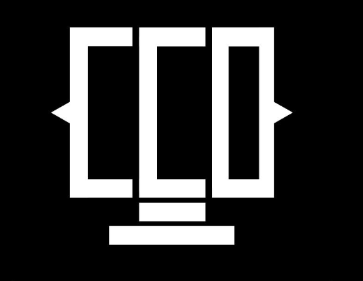

<div align="center">
  
</div>

# Mostra de Profissões 2026 — CACCO

Cinco experiências interativas desenvolvidas pelo **Centro Acadêmico de Ciência da Computação (CACCO)** para a **IV Mostra de Profissões da UNIFEI, Campus Itabira**.

No lobby, escolha uma atividade para cortar frutas, deformar sólidos, explorar o Sistema Solar, guiar o Gaguinho entre dutos ou praticar pontaria. Todas as experiências rodam no navegador e podem ser usadas com a **webcam** ou com o **mouse**.

## Experiências

| Atividade | Como jogar |
| --- | --- |
| **Corte no Ar** | Controle a lâmina com o indicador, a palma ou o mouse. Em uma rodada de 45 segundos, cada fruta soma 10 pontos e acertar o Gaguinho tira 20. O ranking local guarda as dez melhores partidas salvas. |
| **Polígonos 3D** | Faça uma pinça com o polegar e o indicador sobre um vértice rosa e mova a mão para deformar o sólido. Faça a pinça fora do vértice para girar ou use duas pinças para ajustar o zoom. Com o mouse, arraste a cena ou o vértice e use a roda para aproximar. Escolha entre cubo, pirâmide e octaedro. |
| **Sistema Solar** | Aponte para um astro por 2 segundos para selecioná-lo. Uma pinça gira a vista e duas ajustam o zoom. Com o mouse, clique no astro, arraste para girar e use a roda para aproximar. Procure o sinal rosado além de Netuno para descobrir o Mundo Gaguinho. |
| **Voo do Gaguinho** | Suba ou desça a palma ou o indicador para controlar a altura. Também dá para jogar com mouse, toque ou as setas do teclado. Cada abertura atravessada vale 1 ponto. A rodada dura até 90 segundos, com dutos mais rápidos e aberturas menores à medida que o tempo passa. |
| **Tiro ao Alvo** | Mire com a mão aberta. Quando a mira ficar rosa, feche a mão para atirar na última posição da mira e reabra para preparar o próximo disparo. Com o mouse, clique para atirar. No teclado, use as setas e Espaço. |

### Tiro ao Alvo

A rodada dura **30 segundos**. Aparecem até **dois alvos por vez**, e cada um fica visível por até **5,5 segundos**. O centro vale **30 pontos**, o anel intermediário vale **20** e o externo vale **10**. A arena e o lançador permanecem fixos no disparo. Ao final, o jogo exibe a pontuação, a porcentagem de acertos e o recorde local.

### Gestos do Sistema Solar

- **Girar um astro no próprio eixo.** Selecione o astro e feche a mão até as pontas dos dedos ficarem amarelas.
- **Mover um planeta na órbita.** Selecione o planeta, espere o reconhecimento da palma aberta e mova a mão para o lado.
- **Montar do zero.** Encoste o polegar no dedo médio à frente da palma, espere as pontas amarelas e solte. O primeiro gesto acende o Sol. Os seguintes revelam um planeta por vez. Use o botão da atividade para montar também com o mouse.

A cena usa tamanhos, distâncias e velocidades ilustrativos. O Mundo Gaguinho é um planeta fictício criado para a Mostra.

## Como rodar o pacote offline

**Requisitos.** Node.js instalado, um navegador como Chrome ou Edge e uma webcam apenas se você quiser usar gestos. O ZIP distribuído para a Mostra já inclui a versão compilada em `dist/`, o modelo de rastreamento e as texturas. Com o pacote extraído e o Node.js instalado, não é necessário rodar `npm install` ou ter conexão com a internet.

1. Extraia o ZIP inteiro.
2. No Windows, dê dois cliques em `Jogar.cmd` na pasta extraída. No Linux ou macOS, execute `node scripts/jogar.mjs` nessa pasta.
3. Abra o [lobby no navegador](http://127.0.0.1:4173/) se ele não abrir sozinho. Mantenha o terminal aberto durante a sessão.
4. Escolha uma atividade. Se for jogar por gestos, clique na opção de webcam e permita o acesso à câmera.

## Como funciona

O **Hand Landmarker**, do MediaPipe Tasks Vision, estima **21 pontos por mão** a partir dos quadros da webcam. O código interpreta a posição e o movimento desses pontos para reconhecer gestos e controlar cada atividade. No Corte no Ar, por exemplo, o jogo verifica se o trajeto da lâmina entre duas posições cruzou uma fruta. O processamento ocorre no próprio navegador.

**Tecnologias.** TypeScript, Vite, HTML, CSS, Canvas 2D, MediaPipe Tasks Vision e Web Workers. O Sistema Solar usa Three.js e WebGL 2, com uma versão simplificada em Canvas 2D quando o WebGL 2 não está disponível. O servidor offline usa Node.js.

## Desenvolvimento

Use **Node.js 24 ou superior**. Execute os comandos abaixo na raiz do projeto.

```bash
npm ci
npm run dev
```

Abra o endereço que o Vite mostrar no terminal. No PowerShell, você pode usar `npm.cmd` no lugar de `npm`.

| Comando | Finalidade |
| --- | --- |
| `npm run build` | Verifica os tipos e gera o site em `dist/`. |
| `npm test` | Executa os testes de rastreamento e das atividades. |
| `npm run check` | Executa a análise de código, os testes e a compilação. |
| `npm run jogar` | Serve a versão compilada de `dist/` no endereço local do estande. |

### Onde encontrar o código

| Caminho | Conteúdo |
| --- | --- |
| [`index.html`](index.html) e [`src/lobby.ts`](src/lobby.ts) | Lobby e seleção das atividades. |
| [`src/match-controller.ts`](src/match-controller.ts) e [`src/game.ts`](src/game.ts) | Controles, rodada e colisões do Corte no Ar. |
| [`src/poligonos/`](src/poligonos/) | Sólidos 3D e interação com os vértices. |
| [`src/solar/`](src/solar/) | Cena, planetas e gestos do Sistema Solar. |
| [`src/arcade/`](src/arcade/) | Voo do Gaguinho, Tiro ao Alvo e controles compartilhados. |
| [`public/vision/`](public/vision/) e [`public/solar/`](public/solar/) | Modelo, arquivos do MediaPipe e texturas usadas offline. |

## Créditos

- **CACCO**, desenvolvimento e identidade visual do projeto.
- **Visão computacional**, MediaPipe Tasks Vision e modelo Hand Landmarker. Consulte a [licença do MediaPipe](LICENSE-MediaPipe.txt).
- **Polígonos 3D**, inspirado na demonstração de edição de vértices e rotação do [Shape Creator](https://github.com/collidingScopes/shape-creator-tutorial).
- **Sistema Solar**, inspirado na [palestra de Liad Yosef na JSNation 2022](https://gitnation.com/contents/build-a-3d-solar-system-with-hand-recognition-and-threejs). Texturas do [Solar System Scope](https://www.solarsystemscope.com/textures/) sob [CC BY 4.0](https://creativecommons.org/licenses/by/4.0/). Consulte também a [licença do Three.js](LICENSE-ThreeJS.txt).

Veja as demais referências em [`CREDITOS.txt`](CREDITOS.txt).
